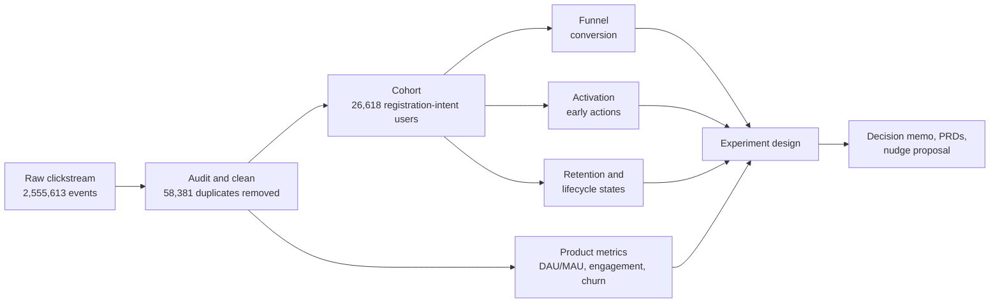
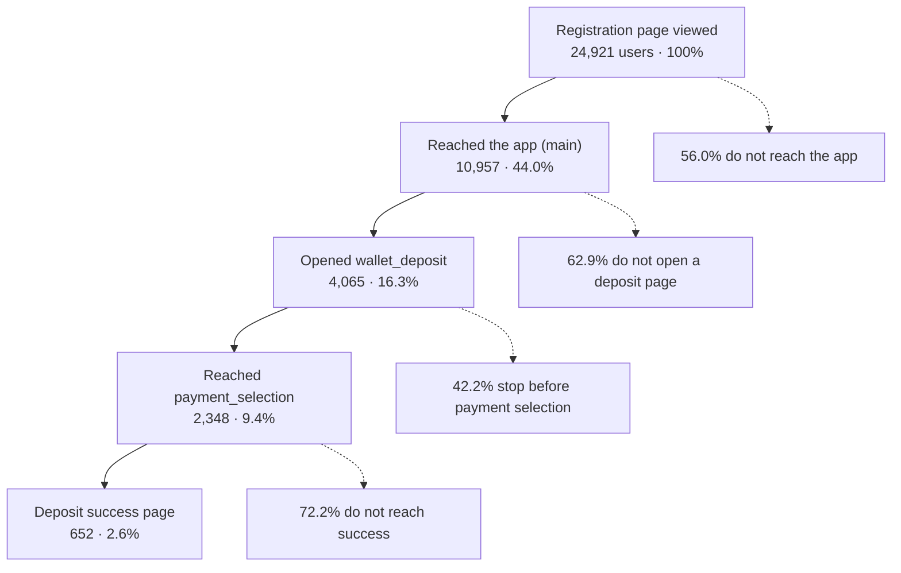
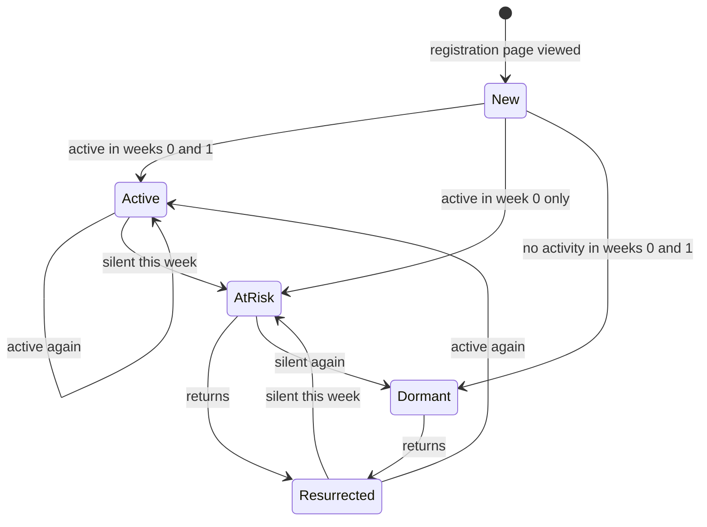
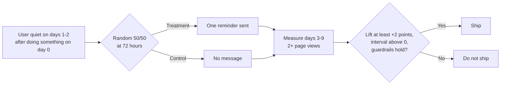

# Fintech Product Lifecycle Analytics

**Where do new wallet-app users drop off, who comes back, and what should a product team test first?**

An end-to-end product analytics project on a public e-wallet clickstream: data audit, funnel, activation, retention, lifecycle states, core product metrics (DAU/MAU, engagement, churn), an experiment design, and the product documents (decision memo, PRDs, nudge proposal) that follow from the findings.

**Author:** Kowshik · [GitHub](https://github.com/kowshikkkkkk)
**Stack:** Python, SQL (DuckDB), pandas · Mixpanel import pipeline
**Status:** Analysis and documents complete. The A/B test is a *design*, not a test that was run.

---

## At a glance

| Question | Answer (public sample, Jan to Apr 2021) |
|---|---|
| How many new users reach a deposit-success page within 7 days? | **2.7%** (680 of 24,921); **44.0%** reach the app |
| Where is the biggest drop-off? | Registration to app (56.0% lost) and payment selection to success (72.2% lost) |
| How many come back? | **10.0 to 10.5%** in week 1, **4.3 to 4.9%** in week 4, **3.2%** in week 8 |
| What happens after week 1? | 60 to 72% are *at-risk*; only **4.3 to 4.7%** of them return the next week |
| Stickiness (DAU/MAU) | **5.8%** for app users, 4.2% for all users |
| Weekly churn | **77.5%** of weekly active app users are gone the next week |
| What to do first? | A randomized **72-hour reminder test** for quiet new users, plus tracking fixes |

> All results describe this modified public sample. They are not industry benchmarks, and most are **associations, not causes**.

---

## The business problem

A digital wallet gains registered users but few of them complete a deposit or keep using the product. A product manager needs to know **where users leave, which early behaviours go with coming back, and what is worth testing**, without over-claiming from the data.

## How the project fits together



---

## Data

- **Source:** [Retentioneering e-wallet dataset](https://doc.retentioneering.com/3.0/doc/datasets/e-wallet.html) (2,555,613 page-view events, 338,828 users, 1 Jan to 7 Apr 2021). Dates and user IDs were modified by the publisher.
- **Licence:** CC BY-NC-SA 4.0 as stated on the source page (archived 3.x documentation). **The data is not included in this repository.** Download it and place it at `data/raw/e_wallet.csv`.
- **What a row is:** one *page view* (`user_id`, `timestamp`, `event` = page name), not a completed action. The data has no device, channel, amount or error fields.

### Data quality (Phase 1)

| Check | Result |
|---|---|
| Nulls, unparseable timestamps | None |
| Exact duplicate rows | 58,381 (2.28%), mostly pairs on pre-login pages. Removed and logged |
| Activity skew | Median user has 1 event; the top 0.1% of users (338) produce 12.0% of all events. Flagged and kept; key results rerun without them |
| Sequence sanity | 66.1% of users who confirmed their email have no earlier verification-page view (likely one person split across devices), so funnels are reported as "reached page", with strict order as a lower bound |

---

## Findings

### 1. Funnel (24,921 users with a full 7-day window)



*The diagram counts users who reached every earlier step (any order). Counting each page independently gives 680 users (2.7%) at the success page.*

- Opening the registration page is not the same as registering, so the first drop partly reflects non-prospects. For users whose very first event was the registration page, only 22.0% reach the app; 34.2% reach any app or signup-stage page.
- **Sensitivity:** excluding the 149 heavy users in the cohort moves every step by 0.8 points or less.

### 2. Activation (association, not cause)

Early action (first 24 hours) versus returning on days 7 to 14. Each raw lift shrinks once users are compared at similar activity levels, because more engaged users do everything more.

| Early action | Raw lift (points) | Within activity bands |
|---|---|---|
| Deposit success page | +17.1 [12.9, 21.3] | +11.9 (only the 10+ events band, 444 users: imprecise) |
| `wallet` | +10.9 | +5.6 |
| `main` | +9.9 | +5.4 |
| `profile` | +9.4 | +3.2 |
| `wallet_deposit` | +8.7 | +2.8 |
| `open_account_main` | +3.8 | -3.3 |

Roughly half or more of each raw lift was general engagement.

### 3. Retention and lifecycle

- **Retention** by week since each user's first registration-page view (eligible users only, so the data end does not bias results): week 1 **10.5%**, week 2 7.3%, week 4 4.9%, week 8 3.2%.
- **Lifecycle states** (weekly, relative to each user's entry):



| Week 1 state (n = 23,046) | Share |
|---|---|
| Active | 10.0% |
| Resurrected | 0.4% |
| At-risk | 72.3% (60.5% under a stricter activity rule) |
| Dormant | 17.2% (29.5% under the stricter rule) |

Of 15,430 at-risk users in week 1, only **4.3%** returned the following week. Dormant users returned 1.4% of the time. *Hypothesis (not validated): the first week after entry is the main window for intervention.*

### 4. Product metrics

| Metric | Definition | Result |
|---|---|---|
| Conversion | Registration-page viewers who reach a deposit-success page within 7 days | 2.7%; 44.0% reach the app |
| Retention | Share with any event in relative week k | Week 1: 10.0 to 10.5%; week 4: 4.3 to 4.9% |
| Churn (weekly) | Active in week t-1 and not active in week t | App users 77.5% (75.9 to 79.1%); all users 88.6% |
| DAU/MAU | Daily active users ÷ users active in the trailing 30 days | App users 5.8% (average DAU 1,450, MAU 24,786); all users 4.2% |
| Engagement | Sessions (30-minute gap) per active user per day; pages per session | 1.24 sessions; median 1 page, mean 4.1; 56.9% of sessions are single-page, 21.7% have 5+ pages |
**North star: weekly depositors** (users with a deposit-success page view in a week): mean 568 per week, about 7.9% of weekly active app users; 23.1% of depositors deposited in 2+ weeks. Inputs: activation (2.7% registration to deposit), engagement (DAU/MAU 5.8%), retention (week 1: 10.0 to 10.5%). The experiment's primary metric (engaged return) is an input metric; guardrails are opt-out and complaint rates (to be measured before launch), with `support` visits (0.40%) as an observed proxy. See [`docs/product_metrics.md`](docs/product_metrics.md).

Full definitions: [`docs/product_metrics.md`](docs/product_metrics.md).

---

## Recommendation and experiment design

**Test a single reminder at 72 hours** for users who did something beyond the registration form on day 0 and then went quiet on days 1 and 2.



| Design element | Value |
|---|---|
| Eligible users | 13,377 in the sample (about 1,089 per week) |
| Primary metric | 2+ non-registration page views on days 3 to 9 (baseline **10.18%**). Requiring 2+ avoids counting a single link click as a "return" |
| Secondary | Any page view on days 3 to 9 (13.49%); reaching `main` (6.41%) |
| Guardrails | Opt-out and complaint rates (no data here, so to be measured before launch); proxies: `support` visits 0.40%, `profile_recovery` visits 1.58% |
| Sample size | 3,897 per arm to detect +2 points (80% power, alpha 0.05), about 7 weeks at this sample's traffic |
| Stopping rule | Fixed horizon, at least two full weeks, no stopping on interim significance, check sample ratio first; stop early only for a guardrail breach |

The reminder is a **hypothesis worth testing**. The data shows where users go quiet; it does not show that a message would bring them back.

---

## Product documents

| Document | Purpose |
|---|---|
| [`docs/decision_memo.md`](docs/decision_memo.md) | One-page recommendation, options, risks |
| [`docs/prd_return_reminder.md`](docs/prd_return_reminder.md) | PRD for the reminder: user stories, requirements, rollout |
| [`docs/prd_measurement_foundations.md`](docs/prd_measurement_foundations.md) | PRD for tracking fixes and pre-launch event testing |
| [`docs/nudge_proposal.md`](docs/nudge_proposal.md) | Target users, message principles, metrics, A/B plan |
| [`docs/experiment_design.md`](docs/experiment_design.md) | Detailed experiment design |
| [`docs/product_metrics.md`](docs/product_metrics.md) | Metric definitions and results |
| [`docs/assumptions_log.md`](docs/assumptions_log.md) | Every assumption and transformation (A1 to A16) |
| [`docs/fix_log.md`](docs/fix_log.md) | Data issues found and how they were handled |
| [`docs/findings.md`](docs/findings.md) | Running log of verified results |
| [`docs/readme_limits.md`](docs/readme_limits.md) | Limits of the data and analysis |

---

## Limits (read these before quoting any number)

- **Page views, not actions.** Registration submission, transfer and withdrawal completion cannot be observed. The only confirmed money movement is a deposit-success page.
- **Deposit failures have no reason code**, so a declined card cannot be told apart from a timeout.
- **One person may appear as several IDs** (for example, an email link opened on another device), which can inflate user counts and break sequences.
- **Dates and IDs were modified** by the publisher, so day-of-week and time-of-day are not used.
- **No device, channel, category or amount fields**, so no such segmentation.
- **Observational data.** Every activation and lifecycle result is an association. The reminder's effect is unknown until tested.
- **Assumptions I chose:** page grouping into in-app and pre-login pages (A15), the 30-minute session rule (A16), and the lifecycle state definitions (A12). The sample is not representative of any real app.
- **Not done:** no live experiment was run, no stakeholder or engineering input was available, and the tracking changes are proposals.

---

## Mixpanel

`src/18_mixpanel_test_import.py` and `src/19_mixpanel_import.py` load the cohort's 825,244 events into Mixpanel (free plan) as a single `Page Viewed` event with a `page_name` property. Timestamps are shifted by a constant 2,002 days to fit Mixpanel's 1,825-day retention window; this preserves every interval and is logged as assumption A9. Report building in Mixpanel was blocked after the free plan's monthly event cap was reached (likely from loading the data twice), so **all results in this repository were computed in Python**.

---

## Repository structure

```
src/
  01_schema_audit.py ... 09_transitions.py     data audit, cleaning, activity and sequence checks
  10_cohort.py ... 14_funnel_sensitivity.py    cohort, funnel, segments, confidence intervals
  15_activation_table.py ... 17_activation_bands.py   activation analysis
  18_mixpanel_test_import.py, 19_mixpanel_import.py   Mixpanel import
  20_retention.py, 21_lifecycle.py, 22_sensitivity.py retention, lifecycle, sensitivity
  23_experiment_baseline.py ... 25_trigger_profile.py experiment baseline, metric options
  26_product_metrics.py                        DAU/MAU, engagement, weekly churn
docs/                                          memo, PRDs, proposals, logs
```

## Reproduce

```bash
python -m venv .venv && source .venv/Scripts/activate   # Windows Git Bash
pip install -r requirements.txt
# place the dataset at data/raw/e_wallet.csv, then run the scripts in numeric order, e.g.:
python src/01_schema_audit.py
python src/03_clean.py          # writes data/processed/events_dedup.csv
python src/10_cohort.py
python src/11_funnel.py
```

Scripts 18 and 19 need a Mixpanel project token in the `MP_PROJECT_TOKEN` environment variable (never committed).

---

## What this project demonstrates

Funnel and drop-off analysis · cohort retention and lifecycle segmentation · activation analysis with a control for activity bias · DAU/MAU, engagement and churn definitions · data-quality audit and event-sequence checks · experiment design (hypothesis, primary and guardrail metrics, sample size, stopping rule) · product documentation (decision memo, PRDs, user stories) · honest handling of data limits.